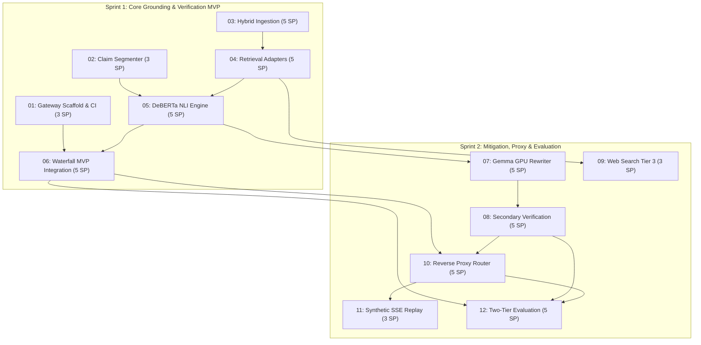

# Two-Sprint Project Backlog: Dehallucination Add-On Module
**Course**: UE24CS341A – Software Engineering (Jackfruit Mini-Project)  
**Total Story Points**: 52 SP (Sprint 1: 26 SP, Sprint 2: 26 SP)  
**Team**: 4 Students | **Hardware Target**: NVIDIA RTX 2050 (4 GB VRAM)  
**Traceability Baseline**: `docs/SRS.md`, `CONTEXT.md`, and ADR-0001 through ADR-0010  

---

## 1. Executive Summary & Team Ownership Distribution

Story points represent relative complexity based on Fibonacci sizing ($1, 2, 3, 5, 8$). Across both sprints, responsibilities are balanced across the four team members according to functional ownership:

| Student | Primary Functional Ownership | Sprint 1 Focus | Sprint 2 Focus | Total Points |
| :--- | :--- | :--- | :--- | :---: |
| **Student 1** | **Gateway & Streaming Proxy** | Gateway Scaffolding, `/verify` endpoint, CI Setup, Sprint 1 MVP integration | OpenAI-compatible Reverse Proxy, Request Buffering, Synthetic SSE Replay | **16 SP** |
| **Student 2** | **Claim Segmentation & NLI Verification** | NLTK Segmenter, CPU DeBERTa-v3 inference, 3-way classification & scoring | NLI threshold calibration, diagnostics, ROC-AUC & Confusion Matrix evaluation | **11 SP** |
| **Student 3** | **Hybrid Knowledge Ingestion & Retrieval** | Multi-format parser (PDF/MD/TXT), Qdrant+BM25 dual store, RRF adapters | Opt-in DuckDuckGo Tier 3 web search adapter, retrieval metrics (Recall@K, MRR) | **13 SP** |
| **Student 4** | **Mitigation & Secondary Verification** | GPU Gemma 4-bit VRAM spike & compatibility verification (derisking) | Gemma targeted rewriter, secondary verification loop, mitigation fallback, Tier A/B benchmark harness | **12 SP** |
| **Total** | | **26 SP** | **26 SP** | **52 SP** |

---

## 2. Sprint 1: Core Grounding & Verification MVP (26 SP)
**Timeline**: 19th Oct to 23rd Oct (Dry run practice: 12th Oct to 16th Oct)  
**Sprint 1 Goal**: Deliver a working end-to-end verification service where a client can submit text, ingest documents, segment claims, retrieve hybrid evidence, and receive a 3-way NLI score.  
**Deliverable**: Working `/verify` endpoint + 1-minute demonstration video uploaded to repository.

| Ticket ID | Ticket Title | Owner | Story Points | Dependencies | SRS Reference | Priority |
| :---: | :--- | :---: | :---: | :---: | :---: | :---: |
| [**01**](./sprint-1/01-gateway-scaffolding-and-ci.md) | Core Gateway Scaffolding, Verification Endpoint & CI Pipeline | Student 1 | 3 SP | None | REQ-GW-01, REQ-GW-02 | High (Done) |
| [**02**](./sprint-1/02-claim-segmenter.md) | Deterministic Sentence & Clause Claim Segmenter | Student 2 | 3 SP | None | REQ-VER-01, REQ-VER-02, REQ-VER-03 | High (Done) |
| [**03**](./sprint-1/03-hybrid-ingestion.md) | Hybrid Knowledge Ingestion & Deterministic Dual-Index Store | Student 3 | 5 SP | None | REQ-RET-01, REQ-RET-02, REQ-RET-03 | High (Done) |
| [**04**](./sprint-1/04-hybrid-retrieval-adapters.md) | Hybrid Retrieval Adapters & Reciprocal Rank Fusion (Tiers 1 & 2) | Student 3 | 5 SP | Ticket 03 | REQ-RET-04, REQ-RET-05 | High (Done) |
| [**05**](./sprint-1/05-nli-verification.md) | CPU-Based DeBERTa-v3 NLI Verification & Reliability Scoring | Student 2 | 5 SP | Ticket 02, Ticket 04 | REQ-VER-04, REQ-VER-05, REQ-VER-06 | High (Done) |
| [**06**](./sprint-1/06-waterfall-integration-mvp.md) | NLI-Aware Waterfall Orchestration & Sprint-1 MVP Integration | Student 1 | 5 SP | Ticket 01, Ticket 05 | REQ-GW-02, REQ-RET-05 | High (Done) |

*(Note: Student 4 conducts a parallel GPU Spike in Sprint 1 to benchmark 4-bit Gemma VRAM allocation on the RTX 2050 before Sprint 2).*

---

## 3. Sprint 2: Mitigation, Reverse Proxy, Streaming & Benchmark (26 SP)
**Timeline**: 26th Oct to 30th Oct  
**Sprint 2 Goal**: Complete the transparent reverse proxy with full buffering, synthetic SSE streaming, local Gemma targeted rewriting with secondary verification, opt-in web search, and empirical benchmark evaluation.  
**Deliverable**: Complete product freeze + 2-minute demonstration video + Final Project Report.

| Ticket ID | Ticket Title | Owner | Story Points | Dependencies | SRS Reference | Priority |
| :---: | :--- | :---: | :---: | :---: | :---: | :---: |
| [**07**](./sprint-2/07-gemma-gpu-rewriter.md) | Quantized Local Gemma GPU Generator & Targeted Rewriter | Student 4 | 5 SP | Ticket 05 | REQ-MIT-01, REQ-MIT-02 | High (Done) |
| [**08**](./sprint-2/08-secondary-verification-fallback.md) | Secondary Verification Loop & Mitigation Fallback Cascade | Student 4 | 5 SP | Ticket 07 | REQ-MIT-03, REQ-MIT-04 | High |
| [**09**](./sprint-2/09-web-retrieval-adapter.md) | Opt-In Tier 3 External Web Retrieval (DuckDuckGo) | Student 3 | 3 SP | Ticket 04 | REQ-RET-05, REQ-RET-06, NFR-SEC-01 | Medium |
| [**10**](./sprint-2/10-reverse-proxy-buffering.md) | OpenAI-Compatible Reverse Proxy & Full Request Buffering | Student 1 | 5 SP | Ticket 06, Ticket 08 | REQ-GW-01, REQ-GW-03 | High |
| [**11**](./sprint-2/11-synthetic-sse-replay.md) | Synthetic SSE Replay Streaming Engine | Student 1 | 3 SP | Ticket 10 | REQ-GW-04, ADR-0008 | Medium |
| [**12**](./sprint-2/12-two-tier-evaluation-benchmark.md) | Two-Tier Evaluation Harness & Empirical Benchmark Suite | Student 4 & Student 2 | 5 SP | Ticket 06, Ticket 08, Ticket 10 | REQ-MIT-06, NFR-QUAL-02, NFR-QUAL-03 | High |

---

## 4. Technical Dependency Graph

---

## 5. Definition of Done (DoD) Across Tickets

Before any pull request can be merged into `main`:
1. **Vertical Completeness**: The ticket's functionality is accessible through its typed interface/API and verified end-to-end.
2. **Automated Testing**: Unit tests are added under `tests/` with $\ge 80\%$ statement coverage for the new module.
3. **Continuous Integration**: The GitHub Actions CI pipeline passes all checks (formatting, type checks, unit tests) without warnings.
4. **Peer Review**: A peer team member reviews and approves the PR.
5. **No Hallucination Leakage / Zero OOM**: GPU VRAM remains $\le 3.5\text{ GB}$ at all times on the RTX 2050.
