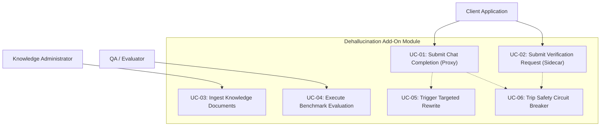
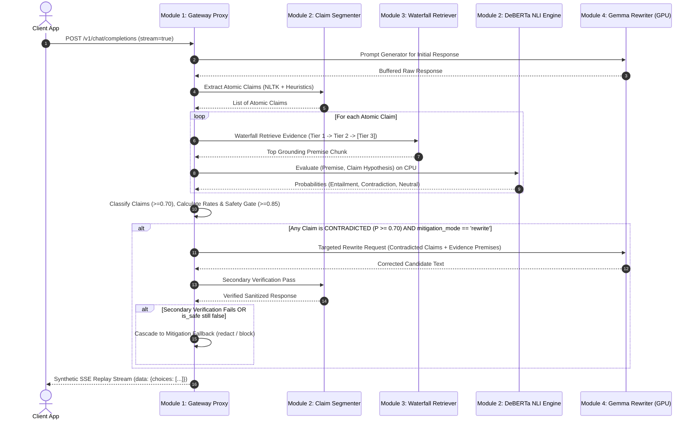

# Software Requirements Specification (SRS)
## Dehallucination Add-On Module for Enhancing Reliability of AI Applications
**Course**: UE24CS341A – Software Engineering (Jackfruit Mini-Project)  
**Department**: Computer Science and Engineering, PES University, Bangalore  
**Document Version**: 1.0 (Approved)  
**Status**: Baselines Confirmed via ADR-0001 through ADR-0010  

---

## Revision History

| Name | Date | Reason For Changes | Version |
| :--- | :--- | :--- | :--- |
| Core Engineering Team | 2026-11-14 | Initial baseline creation via `/grill-with-docs` session | 1.0 |

---

## Table of Contents

- [1. Introduction](#1-introduction)
  - [1.1 Purpose](#11-purpose)
  - [1.2 Intended Audience and Reading Suggestions](#12-intended-audience-and-reading-suggestions)
  - [1.3 Product Scope](#13-product-scope)
  - [1.4 References](#14-references)
- [2. Overall Description](#2-overall-description)
  - [2.1 Product Perspective](#21-product-perspective)
  - [2.2 Product Functions](#22-product-functions)
  - [2.3 User Classes and Characteristics](#23-user-classes-and-characteristics)
  - [2.4 Operating Environment](#24-operating-environment)
  - [2.5 Design and Implementation Constraints](#25-design-and-implementation-constraints)
  - [2.6 Assumptions and Dependencies](#26-assumptions-and-dependencies)
- [3. External Interface Requirements](#3-external-interface-requirements)
  - [3.1 User Interfaces](#31-user-interfaces)
  - [3.2 Software Interfaces](#32-software-interfaces)
  - [3.3 Communications Interfaces](#33-communications-interfaces)
  - [3.4 Hardware Interfaces](#34-hardware-interfaces)
- [4. Analysis Models](#4-analysis-models)
  - [4.1 Use Case Diagram](#41-use-case-diagram)
  - [4.2 System Data Flow & Sequence Diagram](#42-system-data-flow--sequence-diagram)
- [5. System Features & Functional Ownership](#5-system-features--functional-ownership)
  - [5.1 Feature 1: Gateway & Streaming Proxy Engine (Owner: Student 1)](#51-feature-1-gateway--streaming-proxy-engine-owner-student-1)
  - [5.2 Feature 2: Claim Segmentation & NLI Verification Engine (Owner: Student 2)](#52-feature-2-claim-segmentation--nli-verification-engine-owner-student-2)
  - [5.3 Feature 3: Hybrid Knowledge Ingestion & Retrieval Engine (Owner: Student 3)](#53-feature-3-hybrid-knowledge-ingestion--retrieval-engine-owner-student-3)
  - [5.4 Feature 4: Targeted Mitigation & Secondary Verification Engine (Owner: Student 4)](#54-feature-4-targeted-mitigation--secondary-verification-engine-owner-student-4)
- [6. Other Nonfunctional Requirements](#6-other-nonfunctional-requirements)
  - [6.1 Performance Requirements](#61-performance-requirements)
  - [6.2 Safety Requirements](#62-safety-requirements)
  - [6.3 Security Requirements](#63-security-requirements)
  - [6.4 Software Quality Attributes](#64-software-quality-attributes)
  - [6.5 Business Rules](#65-business-rules)
- [7. Other Requirements](#7-other-requirements)
- [Appendix A: Glossary](#appendix-a-glossary)
- [Appendix B: Field Layouts & Data Schemas](#appendix-b-field-layouts--data-schemas)
- [Appendix C: Requirement Traceability Matrix (RTM)](#appendix-c-requirement-traceability-matrix-rtm)

---

## 1. Introduction

### 1.1 Purpose
This Software Requirements Specification (SRS) defines the functional, interface, performance, and verification requirements for the **Dehallucination Add-On Module for Enhancing Reliability of AI Applications** (Project ID: 39). It specifies the behavioral contracts for the dual-mode gateway, deterministic claim extraction, multi-tier evidence retrieval, local Natural Language Inference (NLI) scoring, and local targeted mitigation pipelines.

### 1.2 Intended Audience and Reading Suggestions
This document is prepared for:
- **Academic Evaluators and Faculty Reviewers**: Reviewing compliance with UE24CS341A software engineering and individual functional ownership requirements.
- **Development Team Members (Students 1 to 4)**: Implementing modular components, typing contracts, and writing unit/integration test suites.
- **System Integrators & API Consumers**: Integrating the transparent OpenAI-compatible proxy or explicit verification sidecar into external AI applications.

### 1.3 Product Scope
Large Language Models (LLMs) frequently generate plausible-sounding but factually contradictory or ungrounded assertions ("hallucinations"). The Dehallucination Add-On Module acts as an intelligent intermediary. It intercepts raw or generated responses, extracts atomic factual claims, validates each claim against a tiered hierarchy of ground truth (prompt context, local hybrid vector/keyword stores, and external search), assigns an empirical reliability score, and optionally executes local, self-correcting rewrites using a GPU-hosted Gemma model before delivery.

### 1.4 References
1. IEEE Std 830-1998: *IEEE Recommended Practice for Software Requirements Specifications*.
2. PES University Department of CSE: *Jackfruit Mini-Project Guidelines (UE24CS341A)*.
3. Thorne et al.: *FEVER: A Large-scale Dataset for Fact Extraction and VERification*, NAACL-HLT 2018.
4. Li et al.: *HaluEval: A Large-Scale Hallucination Evaluation Benchmark for Large Language Models*, EMNLP 2023.
5. Project Architectural Decision Records: `docs/adr/0001` through `docs/adr/0010`.

---

## 2. Overall Description

### 2.1 Product Perspective
The system is an autonomous, dual-mode add-on service. It can be deployed as an inline reverse proxy sitting between user-facing clients and generative models, or as a standalone sidecar verification API queried programmatically by pipelines and evaluation harnesses.

```
+-------------------------------------------------------------------------+
|                         Downstream Application                          |
+-------------------+---------------------------------+-------------------+
                    | (POST /v1/chat/completions)     | (POST /verify)
                    v                                 v
+-------------------------------------------------------------------------+
|                  DEHALLUCINATION GATEWAY (FastAPI)                      |
|                                                                         |
|  +--------------------+   +---------------------+   +----------------+  |
|  | Module 1: Proxy/SSE|-->| Module 2: Claim NLI |-->| Module 4:      |  |
|  | Buffering Engine   |   | Segmentation Engine |   | Mitigation/    |  |
|  +--------------------+   +----------+----------+   | Rewriter (GPU) |  |
|                                      |              +----------------+  |
|                                      v                                  |
|                           +---------------------+                       |
|                           | Module 3: Waterfall |                       |
|                           | Retrieval (Qdrant)  |                       |
|                           +---------------------+                       |
+-------------------------------------------------------------------------+
```

### 2.2 Product Functions
- **Dual-Mode Access**: Intercepts OpenAI-format chat requests or serves dedicated batch/single verification requests.
- **Deterministic Atomization**: Splits compound sentences into testable factual hypotheses without consuming generative tokens.
- **Three-Tier Waterfall Retrieval**: Sequentially checks in-context documents (Tier 1), local hybrid Qdrant+BM25 indices (Tier 2), and opt-in DuckDuckGo web search (Tier 3).
- **Three-Way NLI Claim Classification**: Employs CPU-hosted DeBERTa-v3 to label claims as `SUPPORTED`, `CONTRADICTED`, or `UNVERIFIED`.
- **System Safety Gating**: Evaluates document reliability rates and trips a boolean circuit breaker (`is_safe = false`) upon high-confidence contradiction.
- **Targeted Self-Correction**: Re-generates only disproven sentences via local Gemma on GPU while holding supported facts constant, followed by mandatory secondary re-verification.
- **Persistent Knowledge Ingestion**: Unifies text extraction and indexing for PDF, Markdown, and TXT files.

### 2.3 User Classes and Characteristics
- **Client Application Developers**: Require zero-code migration via drop-in OpenAI base URL redirection.
- **Enterprise Knowledge Administrators**: Require secure, air-gapped document ingestion into Qdrant/BM25 with strict prevention of external web data leakage.
- **QA Engineers & Evaluators**: Require detailed claim breakdown, probability distributions, and automated benchmarking scripts.

### 2.4 Operating Environment
- **Operating System**: Windows 11 / Linux (Ubuntu 22.04 LTS).
- **Hardware Profile**: 
  - Host RAM: $\ge 16\text{ GB}$.
  - GPU: Dedicated NVIDIA GPU with $\ge 4\text{ GB}$ VRAM (Baseline: NVIDIA GeForce RTX 2050 Mobile).
  - Storage: $\ge 20\text{ GB}$ free SSD storage for model weights and vector persistence.
- **Software Dependencies**: Python 3.11, CUDA 12.x / 13.x, PyTorch 2.2+, Transformers 4.40+, Qdrant-Client 1.9+, FastAPI 0.111+.

### 2.5 Design and Implementation Constraints
- **VRAM Constraint (CON-01)**: Generator LLM (Gemma 4B) must operate within 4 GB VRAM via INT4/4-bit quantization.
- **Split-Compute Constraint (CON-02)**: Dense embeddings and NLI cross-encoders must execute on host CPU threads to avoid GPU OOM crashes (ADR-0002).
- **Air-Gap Constraint (CON-03)**: Tier 3 external search is strictly opt-in; the server enforces an unbypassable ceiling (`SERVER_MAX_TIER`).
- **Buffering Constraint (CON-04)**: Streaming requests must be buffered in full prior to emitting synthetic SSE chunks to prevent unverified token leakage.

### 2.6 Assumptions and Dependencies
- NLI thresholds ($\tau_e = 0.70, \tau_c = 0.70, \text{safety} = 0.85$) are initial operational defaults requiring experimental calibration on FEVER/HaluEval validation splits.
- Local Qdrant operates in embedded disk-storage mode (`./data/qdrant_storage`), requiring no external Docker daemon for core operation.

---

## 3. External Interface Requirements

### 3.1 User Interfaces
- **Diagnostic Swagger/OpenAPI UI**: Auto-generated interactive documentation available at `/docs` for testing `/verify` and `/knowledge/ingest`.
- **CLI Ingestion Utility**: Console tool (`python -m src.ingest --path <dir>`) providing progress bars and chunking summaries.

### 3.2 Software Interfaces
- **OpenAI Client SDK Compatibility**: Emulates `/v1/chat/completions` API schema supporting standard `messages`, `temperature`, `model`, and `stream` parameters.
- **Local Gemma Generator Interface**: HuggingFace `transformers` pipeline executing 4-bit quantized Gemma inference on `cuda:0`.
- **NLI Engine Interface**: HuggingFace `cross-encoder/nli-deberta-v3-base` running on `cpu`.
- **Vector Database**: `qdrant-client` local file-backed persistence.
- **External Search**: `duckduckgo-search` asynchronous query client.

### 3.3 Communications Interfaces
- **HTTP / HTTPS**: RESTful communication using JSON request/response payloads over port 8000.
- **Server-Sent Events (SSE)**: Standard `text/event-stream` protocol for OpenAI streaming compatibility.

### 3.4 Hardware Interfaces
- **NVIDIA CUDA Driver Interface**: Standard PyTorch CUDA runtime bindings for GPU memory allocation and tensor operations.

---

## 4. Analysis Models

### 4.1 Use Case Diagram



### 4.2 System Data Flow & Sequence Diagram



---

## 5. System Features & Functional Ownership

### 5.1 Feature 1: Gateway & Streaming Proxy Engine (Owner: Student 1)
#### 5.1.1 Description and Priority
- **Description**: Exposes public REST endpoints, buffers incoming requests, emulates OpenAI chat completion protocols, manages client configuration overrides, and serializes streaming output via synthetic SSE replay.
- **Priority**: High (System Entry Point)

#### 5.1.2 Stimulus/Response Sequences
- *Stimulus*: Client sends `POST /v1/chat/completions` with payload `{"messages": [...], "stream": true}`.
- *Response*: Gateway captures prompt, coordinates internal generation/verification, and streams finalized tokens via SSE chunks ending with `data: [DONE]`.

#### 5.1.3 Functional Requirements
- **REQ-GW-01**: The system shall provide an OpenAI-compatible endpoint at `POST /v1/chat/completions`.
- **REQ-GW-02**: The system shall provide a standalone programmatic endpoint at `POST /verify` accepting text, prompt, and optional reference context.
- **REQ-GW-03**: The system shall buffer 100% of generated upstream tokens prior to releasing streaming data when `stream: true` is requested.
- **REQ-GW-04**: The system shall emit verified responses formatted as standard Server-Sent Event (SSE) packets matching the OpenAI delta schema.
- **REQ-GW-05**: The system shall read and enforce caller-specified headers: `X-Max-Tier` (1, 2, or 3) and `X-Mitigation-Mode` (`flag`, `rewrite`, `redact`, `block`).

---

### 5.2 Feature 2: Claim Segmentation & NLI Verification Engine (Owner: Student 2)
#### 5.2.1 Description and Priority
- **Description**: Segments generated text into verifiable atomic propositions without LLM calls, coordinates CPU-based inference via `cross-encoder/nli-deberta-v3-base`, computes document-level metrics, and manages safety gating.
- **Priority**: High (Core Verification Logic)

#### 5.2.2 Stimulus/Response Sequences
- *Stimulus*: Gateway passes generated text string to the Segmentation Engine.
- *Response*: Segmentation engine returns a list of atomic claim strings within 5 ms.
- *Stimulus*: Engine receives a list of `(Premise, Claim)` pairs.
- *Response*: Engine outputs three-way classification labels, probability distributions, document reliability rates, and safety gate boolean flags.

#### 5.2.3 Functional Requirements
- **REQ-VER-01**: The system shall tokenize text into sentences using `nltk.sent_tokenize`.
- **REQ-VER-02**: The system shall split compound sentences into independent atomic claims only when distinct independent clauses with explicit subjects and predicates exist.
- **REQ-VER-03**: The system shall preserve epistemic hedges (e.g. *"I believe..."*, *"According to sources..."*) and verify the underlying factual claim rather than discarding the sentence.
- **REQ-VER-04**: The system shall execute `cross-encoder/nli-deberta-v3-base` inference strictly on CPU threads and classify claims using initial thresholds:
  - `SUPPORTED`: $P(\text{entailment}) \ge 0.70$
  - `CONTRADICTED`: $P(\text{contradiction}) \ge 0.70$
  - `UNVERIFIED`: Neither condition met.
- **REQ-VER-05**: The system shall calculate document-level metrics:
  $$\text{Hallucination Rate} = \frac{N_{\text{contradicted}}}{N_{\text{total}}} \times 100\%$$
  $$\text{Verification Rate} = \frac{N_{\text{supported}}}{N_{\text{total}}} \times 100\%$$
  $$\text{Unverified Rate} = \frac{N_{\text{unverified}}}{N_{\text{total}}} \times 100\%$$
- **REQ-VER-06**: The system shall set `is_safe = false` if any claim has $P(\text{contradiction}) \ge 0.85$, and raise `needs_review = true` if any claim remains `UNVERIFIED`.

---

### 5.3 Feature 3: Hybrid Knowledge Ingestion & Retrieval Engine (Owner: Student 3)
#### 5.3.1 Description and Priority
- **Description**: Parses, chunks, and persists reference documents in synchronized Qdrant vector and BM25 keyword stores; executes waterfall retrieval with Reciprocal Rank Fusion and opt-in Tier 3 web search.
- **Priority**: High (Grounding Subsystem)

#### 5.3.2 Stimulus/Response Sequences
- *Stimulus*: Administrator submits a PDF, Markdown, or TXT file via `/knowledge/ingest`.
- *Response*: System chunks document, calculates embeddings on CPU, stores vectors in Qdrant and keywords in BM25 with shared deterministic IDs, returning HTTP 201 with chunk count.
- *Stimulus*: Verification engine requests evidence for an atomic claim with `max_tier=2`.
- *Response*: System executes Waterfall search across Tier 1, then Tier 2 (RRF), returning top matching premise chunk.

#### 5.3.3 Functional Requirements
- **REQ-RET-01**: The system shall extract text from PDF, Markdown, and TXT files and segment them into chunks of 250–300 tokens with a 50-token overlap.
- **REQ-RET-02**: The system shall assign identical SHA-256 deterministic chunk IDs to entries stored in both Qdrant and BM25.
- **REQ-RET-03**: The system shall persist vector embeddings in local disk-backed Qdrant storage (`./data/qdrant_storage`) and sparse indexes in disk-serialized BM25 files.
- **REQ-RET-04**: The system shall merge dense and sparse search rankings using Reciprocal Rank Fusion (RRF) with constant $k=60$:
  $$RRF(d) = \frac{1}{60 + \text{rank}_{\text{dense}}(d)} + \frac{1}{60 + \text{rank}_{\text{sparse}}(d)}$$
- **REQ-RET-05**: The system shall execute Waterfall Retrieval: query Tier 1 (prompt context), escalate to Tier 2 on neutral/inconclusive evidence, and escalate to Tier 3 only if `max_tier == 3`.
- **REQ-RET-06**: The system shall enforce an immutable server-side ceiling (`SERVER_MAX_TIER`) preventing unauthorized web search escalation.

---

### 5.4 Feature 4: Targeted Mitigation & Secondary Verification Engine (Owner: Student 4)
#### 5.4.1 Description and Priority
- **Description**: Hosts the local 4-bit Gemma model on the GPU, executes surgical prompt-guided rewrites for contradicted claims, enforces mandatory secondary verification, and provides automated fallback redaction and two-tier benchmark harnesses.
- **Priority**: High (Mitigation & Evaluation Subsystem)

#### 5.4.2 Stimulus/Response Sequences
- *Stimulus*: Gateway triggers `rewrite` mitigation on a response containing 2 contradicted claims.
- *Response*: Local Gemma generates a revised response amending contradicted sentences using provided premises.
- *Stimulus*: Rewritten text is submitted for secondary verification.
- *Response*: Secondary verification passes $\rightarrow$ emit text; secondary verification fails $\rightarrow$ cascade to `redact` or `block`.

#### 5.4.3 Functional Requirements
- **REQ-MIT-01**: The system shall load and execute the local Gemma model in 4-bit quantization on GPU (`cuda:0`), consuming $\le 2.5\text{ GB}$ VRAM.
- **REQ-MIT-02**: The system shall construct targeted rewrite prompts instructing Gemma to amend only `CONTRADICTED` claims using retrieved evidence premises while leaving supported claims unaltered.
- **REQ-MIT-03**: The system shall submit all rewritten outputs to a mandatory single secondary verification pass (REQ-VER-01 through REQ-VER-06).
- **REQ-MIT-04**: If secondary verification detects residual contradictions, the system shall cascade to `redact` (masking contradicted sentences with a warning) or `block` (HTTP 422 / refusal message).
- **REQ-MIT-05**: The system shall never rewrite claims classified as `UNVERIFIED`; they shall be preserved and annotated with advisory flags.
- **REQ-MIT-06**: The system shall provide an automated evaluation harness testing 50 synthetic test cases in `pytest` (Tier A) and calculating Precision, Recall, F1, ROC-AUC, and Recall@K on FEVER/HaluEval validation splits (Tier B).

---

## 6. Other Nonfunctional Requirements

### 6.1 Performance Requirements
- **NFR-PERF-01 (Claim Segmentation Latency)**: Deterministic claim segmentation shall complete in $\le 5\text{ ms}$ for responses up to 500 tokens.
- **NFR-PERF-02 (NLI Inference Latency)**: CPU-based NLI inference shall execute in $\le 80\text{ ms}$ per `(Premise, Claim)` pair on standard x86 multi-core CPUs.
- **NFR-PERF-03 (GPU Memory Footprint)**: Total GPU VRAM usage during generation and targeted rewriting shall never exceed $3.5\text{ GB}$, ensuring zero OOM crashes on 4 GB RTX 2050 hardware.
- **NFR-PERF-04 (End-to-End Latency)**: End-to-end verification (without rewriting) for a 5-claim response shall complete in $\le 500\text{ ms}$ on local hardware.

### 6.2 Safety Requirements
- **NFR-SAFE-01 (Circuit Breaker)**: The gateway shall never release a response marked `is_safe = false` in proxy mode without executing the configured mitigation action.
- **NFR-SAFE-02 (Recursion Prevention)**: Secondary verification shall execute at most once per request; recursive multi-pass correction loops are strictly prohibited to prevent infinite generation hangs.

### 6.3 Security Requirements
- **NFR-SEC-01 (Air-Gap Protection)**: User prompt content and internal claims shall never be transmitted over the internet unless the client explicitly passes `max_retrieval_tier: 3` and `SERVER_MAX_TIER >= 3`.
- **NFR-SEC-02 (Input Validation)**: All incoming payloads must be strictly validated against Pydantic schemas, rejecting oversized or malformed payloads before invoking NLP pipelines.

### 6.4 Software Quality Attributes
- **NFR-QUAL-01 (Modularity)**: Each of the 4 functional modules must be fully decoupled and interact solely via typed Pydantic models.
- **NFR-QUAL-02 (Testability & Coverage)**: The codebase must maintain $\ge 80\%$ statement and branch test coverage validated via `pytest` and `pytest-cov` in GitHub Actions CI.
- **NFR-QUAL-03 (Reproducibility)**: Benchmark scripts must produce deterministic metrics using fixed random seeds and pinned evaluation splits.

### 6.5 Business Rules
- **BR-01**: An `UNVERIFIED` claim shall never be treated as a factual contradiction or hallucination; absence of evidence is not evidence of falsity, and unverified claims shall never trigger factual rewriting.
- **BR-02**: Mitigation triggering and Safety Gating operate as distinct two-tier mechanisms:
  - *Per-Claim Mitigation*: Any claim classified as `CONTRADICTED` ($P(\text{contradiction}) \ge 0.70$) is eligible for the configured mitigation action (`rewrite`, `redact`, `flag`).
  - *Safety Gate Circuit Breaker*: A severe contradiction ($P(\text{contradiction}) \ge 0.85$) trips `is_safe = false`, signaling a high-risk response that enforces hard refusal (`block`) or fallback if targeted rewriting fails.
- **BR-03**: Reverse proxy requests default to `mitigation_mode = rewrite`, whereas standalone sidecar verification requests default to `mitigation_mode = flag`.

---

## 7. Other Requirements
- **Database & Storage Requirements**: Local directory `./data/` must store `./data/qdrant_storage/` and `./data/bm25_index.joblib`.
- **CI/CD Automation**: GitHub Actions workflow must automatically run linting (`flake8`/`black`), type checking (`mypy`), and Tier A unit/integration tests (`pytest`) on every Pull Request.

---

## Appendix A: Glossary

*(Extracted from Project Ubiquitous Language in `CONTEXT.md`)*

- **Atomic Claim**: A single, independent factual proposition extracted from the generated text, capable of being evaluated as a standalone hypothesis by the NLI cross-encoder.
- **Claim Segmenter**: The deterministic component combining NLTK sentence tokenization and rule-based independent clause segmentation to produce atomic claims without LLM inference.
- **Claim State**: The discrete verification label assigned to an atomic claim: `SUPPORTED`, `CONTRADICTED`, or `UNVERIFIED`.
- **Dehallucination**: The process of detecting unsupported or contradictory factual claims in machine-generated text and correcting or flagging them against verified knowledge sources.
- **Deterministic Chunk ID**: A content-hashed identifier assigned to a document chunk, identically referenced in Qdrant and BM25 to guarantee exact alignment during rank fusion.
- **Gateway**: The dual-mode FastAPI service exposing both an OpenAI-compatible reverse proxy (`/v1/chat/completions`) and explicit verification endpoints (`/verify`).
- **Grounding Tier**: The hierarchical classification of evidence sources: Tier 1 (In-Context Documents), Tier 2 (Local Hybrid KB via Qdrant + BM25), and Tier 3 (External Web Search via DuckDuckGo).
- **Mitigation Mode**: The policy governing Gateway action upon detecting contradicted claims: `flag`, `rewrite`, `redact`, or `block`.
- **NLI Cross-Encoder**: A natural language inference model (`cross-encoder/nli-deberta-v3-base`) executing on CPU that evaluates premise-hypothesis pairs to assign entailment, neutral, or contradiction probabilities.
- **Reciprocal Rank Fusion (RRF)**: The rank aggregation algorithm merging dense vector search ranks from Qdrant with sparse keyword ranks from BM25 into a unified relevance list.
- **Safety Gate**: The boolean safety circuit (`is_safe`) that trips to `false` when any single claim exceeds the severe contradiction threshold ($P \ge 0.85$).
- **Secondary Verification**: The re-verification check run against a newly rewritten response to confirm that no secondary hallucinations were introduced during correction.
- **Split Compute Strategy**: The hardware resource partitioning dedicating the 4 GB GPU to the quantized generator LLM while allocating embedding generation and NLI verification to host CPU threads.
- **Synthetic SSE Replay**: The streaming delivery mechanism where an upstream LLM response is buffered, verified, mitigated, and then replayed as simulated Server-Sent Event chunks to maintain client compatibility.
- **Targeted Rewrite**: The correction procedure where the local generator amends only contradicted claims using retrieved evidence premises, preserving supported text and unverified context.
- **Unverified Claim**: An atomic claim for which no sufficient evidence could be retrieved within the allowed retrieval tiers to support or refute it.

---

## Appendix B: Field Layouts & Data Schemas

### B.1 Verification Request Schema (`POST /verify`)

| Field Name | Type | Mandatory | Default | Description |
| :--- | :--- | :---: | :--- | :--- |
| `text` | `string` | Y | - | The generated AI response text to be verified. |
| `prompt` | `string` | N | `""` | The original user prompt that prompted the generation. |
| `context_documents`| `List[string]` | N | `[]` | Tier 1 in-context reference passages. |
| `max_retrieval_tier`| `integer` | N | `2` | Maximum search tier allowed (1=Context, 2=Local KB, 3=Web). |
| `mitigation_mode` | `string` | N | `"flag"` | Desired action: `flag`, `rewrite`, `redact`, `block`. |

### B.2 Verification Response Schema

| Field Name | Type | Mandatory | Description |
| :--- | :--- | :---: | :--- |
| `is_safe` | `boolean` | Y | Overall safety verdict (`false` if high contradiction detected). |
| `needs_review` | `boolean` | Y | Advisory flag (`true` if unverified claims exist). |
| `hallucination_rate`| `float` | Y | Percentage of claims classified as CONTRADICTED. |
| `verification_rate` | `float` | Y | Percentage of claims classified as SUPPORTED. |
| `unverified_rate` | `float` | Y | Percentage of claims classified as UNVERIFIED. |
| `claims` | `List[ClaimReport]`| Y | Array of detailed individual claim evaluations. |
| `sanitized_text` | `string` | Y | Finalized output text (original, rewritten, or redacted). |

### B.3 Individual Claim Report (`ClaimReport`)

| Field Name | Type | Mandatory | Description |
| :--- | :--- | :---: | :--- |
| `claim_id` | `integer` | Y | Sequence index of the claim. |
| `claim_text` | `string` | Y | The extracted atomic proposition string. |
| `state` | `string` | Y | `SUPPORTED`, `CONTRADICTED`, or `UNVERIFIED`. |
| `probabilities` | `Dict[str, float]`| Y | Dict with `entailment`, `neutral`, `contradiction` scores. |
| `evidence_tier` | `integer` | N | Tier from which evidence was retrieved (1, 2, or 3). |
| `evidence_text` | `string` | N | The premise text snippet used for verification. |

---

## Appendix C: Requirement Traceability Matrix (RTM)

| Sl. No | Requirement ID | Brief Description of Requirement | Architecture Reference | Design Reference | Code File Reference | Test Case ID | System Test Case ID |
| :---: | :--- | :--- | :--- | :--- | :--- | :--- | :--- |
| 1 | **REQ-GW-01** | OpenAI-compatible `/v1/chat/completions` proxy | ADR-0001 | Section 5.1 | `src/gateway/router.py` | `UT_GW_01` | `ST_E2E_01` |
| 2 | **REQ-GW-02** | Standalone `/verify` sidecar endpoint | ADR-0001 | Section 5.1 | `src/gateway/router.py` | `UT_GW_02` | `ST_E2E_02` |
| 3 | **REQ-GW-03** | Full response buffering for streaming | ADR-0008 | Section 5.1 | `src/gateway/buffer.py` | `UT_GW_03` | `ST_STR_01` |
| 4 | **REQ-GW-04** | Synthetic SSE replay chunk generator | ADR-0008 | Section 5.1 | `src/gateway/sse.py` | `UT_GW_04` | `ST_STR_02` |
| 5 | **REQ-GW-05** | Header parsing & security tier capping | ADR-0004 | Section 5.1 | `src/gateway/middleware.py` | `UT_GW_05` | `ST_SEC_01` |
| 6 | **REQ-VER-01** | NLTK sentence tokenization | ADR-0003 | Section 5.2 | `src/verifier/segmenter.py`| `UT_VER_01` | `ST_SEG_01` |
| 7 | **REQ-VER-02** | Selective independent clause splitting | ADR-0003 | Section 5.2 | `src/verifier/segmenter.py`| `UT_VER_02` | `ST_SEG_02` |
| 8 | **REQ-VER-03** | Epistemic hedge claim preservation | ADR-0003 | Section 5.2 | `src/verifier/segmenter.py`| `UT_VER_03` | `ST_SEG_03` |
| 9 | **REQ-VER-04** | CPU DeBERTa-v3 3-way NLI classification | ADR-0002, 0005 | Section 5.2 | `src/verifier/nli.py` | `UT_VER_04` | `ST_NLI_01` |
| 10 | **REQ-VER-05** | Document reliability rates calculation | ADR-0005 | Section 5.2 | `src/verifier/metrics.py` | `UT_VER_05` | `ST_NLI_02` |
| 11 | **REQ-VER-06** | Safety gate & review flag logic | ADR-0005 | Section 5.2 | `src/verifier/gate.py` | `UT_VER_06` | `ST_NLI_03` |
| 12 | **REQ-RET-01** | PDF/TXT/MD parsing & 250-token chunking | ADR-0007 | Section 5.3 | `src/retrieval/ingest.py` | `UT_RET_01` | `ST_ING_01` |
| 13 | **REQ-RET-02** | SHA-256 deterministic chunk ID hashing | ADR-0007 | Section 5.3 | `src/retrieval/chunker.py`| `UT_RET_02` | `ST_ING_02` |
| 14 | **REQ-RET-03** | Persistent Qdrant & BM25 store sync | ADR-0007 | Section 5.3 | `src/retrieval/store.py` | `UT_RET_03` | `ST_ING_03` |
| 15 | **REQ-RET-04** | Reciprocal Rank Fusion (RRF k=60) | ADR-0007 | Section 5.3 | `src/retrieval/fusion.py` | `UT_RET_04` | `ST_RET_01` |
| 16 | **REQ-RET-05** | Sequential Waterfall Retrieval logic | ADR-0004 | Section 5.3 | `src/retrieval/waterfall.py`| `UT_RET_05`| `ST_RET_02` |
| 17 | **REQ-RET-06** | Server-side max tier ceiling enforcement | ADR-0004 | Section 5.3 | `src/retrieval/waterfall.py`| `UT_RET_06`| `ST_SEC_02` |
| 18 | **REQ-MIT-01** | 4-bit Gemma GPU generation within 2.5GB | ADR-0002 | Section 5.4 | `src/mitigation/generator.py`| `UT_MIT_01`| `ST_GPU_01` |
| 19 | **REQ-MIT-02** | Targeted prompt rewrite for contradictions | ADR-0006 | Section 5.4 | `src/mitigation/rewriter.py`| `UT_MIT_02` | `ST_MIT_01` |
| 20 | **REQ-MIT-03** | Single secondary verification loop | ADR-0006 | Section 5.4 | `src/mitigation/pipeline.py`| `UT_MIT_03` | `ST_MIT_02` |
| 21 | **REQ-MIT-04** | Fallback cascade to redact / block | ADR-0006 | Section 5.4 | `src/mitigation/fallback.py`| `UT_MIT_04` | `ST_MIT_03` |
| 22 | **REQ-MIT-05** | Non-rewriting of unverified claims | ADR-0006 | Section 5.4 | `src/mitigation/rewriter.py`| `UT_MIT_05` | `ST_MIT_04` |
| 23 | **REQ-MIT-06** | Tier A (50 test) & Tier B (FEVER/HaluEval) | ADR-0009 | Section 5.4 | `tests/eval_benchmark.py` | `UT_MIT_06` | `ST_EVL_01` |
